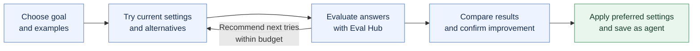

# Playground Optimizer / Recommender

**Find better settings for your agent — try alternatives on the same examples, see what improved, and save the setup you prefer.**

## Why this matters

Today, users tweak settings, chat a few times, and save when the agent feels good enough. This takes time and makes it hard to know whether a change helped.

**Find better settings** adds a guided comparison inside Playground, ending in the familiar **Save as agent** action.

| Today | With Optimize |
|-------|---------------|
| Guess which settings to change | Try a few alternatives within a chosen budget |
| Judge from a handful of chats | Compare every setup on the same task examples |
| Save without clear evidence | See improvement over the current setup and inspect failures |

## The user journey

1. **Choose the goal and examples.** Start with a ready-made test or bring examples of the agent's actual task. Preview what will be checked.
2. **Choose how much to explore.** Set a quick-run budget and which settings may change.
3. **Compare results.** Always include the current setup. Show what changed, how answers scored, and examples that still failed. Results guide the next alternatives.
4. **Confirm and save.** Check the best alternatives on fresh examples, apply the preferred setup, optionally chat, and **Save as agent**.

**Example:** a support assistant answers questions from a policy document. Compare models, instructions, and creativity while keeping the document source fixed. Show which setup gives more relevant, document-supported answers and where it still struggles.

## What can we reuse from Eval Hub?

Eval Hub already groups benchmarks into reusable **collections** and provides evaluation frameworks for scoring. The strongest matches are:

| Goal | Existing asset | What it tells us |
|------|----------------|------------------|
| Follow instructions / return structured output | Instruction Following; Instruction and Output Reliability | Follows constraints and produces valid formats |
| Choose tools correctly | Tool Use (BFCL) | Constructs function calls; does not test the user's complete tool workflow |
| Understand long documents | Document Understanding (RULER) | Understands supplied passages; does not test the user's document search |
| Answer from the user's documents | RAGAS scoring | Evaluates captured answers against retrieved passages and, where needed, references |

**Recommendation:** begin with document-grounded answers and one instruction-following starter. Reuse Eval Hub's scoring; add the search and recommendation loop. Verify that evaluation runs the same settings the user can apply and save.

## Suggested first release

- Compare models, instruction variants, and creativity settings already supported in Playground.
- Keep documents and tool configuration fixed; explore changes to those later.
- Accept user examples from the start, alongside a ready-made starter test.
- Show the current setup, named scores, failure examples, progress, and a clear run budget.
- Apply the selected settings and save the agent with its evaluation record.

Use Playground's **Responses API** execution path and **Eval Hub** evaluation infrastructure. First prove one complete comparison works across both; the integration is a dependency, not an established capability.

**Success:** a non-expert can explain what improved and why, compare it with the current setup, and save an agent without leaving Gen AI Studio. If no alternative improves on the baseline, say so.

